Lớp: NT118.R12.1
Họ và tên: Phạm Nguyễn Thanh Sơn
MSSV: 23521360

# Lab2 LISTVIEW và RECYCLERVIER

## Trường hợp 1: Sử dụng ListView control với mảng dữ liệu định sẵn

### Code

`activity_main.xml`

```xml
<?xml version="1.0" encoding="utf-8"?>
<LinearLayout xmlns:android="http://schemas.android.com/apk/res/android"
    android:layout_width="match_parent"
    android:layout_height="match_parent"
    android:orientation="vertical">

    <TextView
        android:id="@+id/tv_selection"
        android:layout_width="match_parent"
        android:layout_height="wrap_content"
        android:background="@color/green" />

    <ListView
        android:id="@+id/lv_person"
        android:layout_width="match_parent"
        android:layout_height="match_parent"
        android:choiceMode="singleChoice" />

</LinearLayout>
```

`MainActivity.java`

```java
        ListView lvPerson = (ListView) findViewById(R.id.lv_person);
        final TextView tvSelection = (TextView) findViewById(R.id.tv_selection);

        final String arr[] = {"Tèo", "Tý", "Bin", "Bo"};

        ArrayAdapter<String> adapter = new ArrayAdapter<String>(this,
                android.R.layout.simple_list_item_activated_1, arr);

        lvPerson.setAdapter(adapter);

        lvPerson.setOnItemClickListener(new AdapterView.OnItemClickListener() {
            public void onItemClick(AdapterView<?> arg0, View arg1, int arg2, long arg3) {
                tvSelection.setText("position :" + arg2 + " ; value =" + arr[arg2]);
            }
        });
```

`themes.xml`

```xml
<resources>
    <style name="Theme.Lab2_1" parent="Theme.AppCompat.DayNight">
        <item name="colorControlActivated">#FF7FCFE8</item>
    </style>
</resources>
```

### Nhận xét

- Các tên được lưu trong mảng `arr`. `ArrayAdapter` đưa mảng này lên `ListView`, và `setAdapter` nối hai bên lại với nhau.
- Khi bấm vào một tên, `arg2` là vị trí của tên đó. `arr[arg2]` lấy ra tên và hiển thị lên `tvSelection`.
- `choiceMode="singleChoice"` giúp dòng vừa bấm được tô màu.
- Giao diện dùng widget gốc của Android, bố trí theo hình mẫu.

### Kết quả

| Khi mở app | Sau khi chọn "Bin" |
|---|---|
| 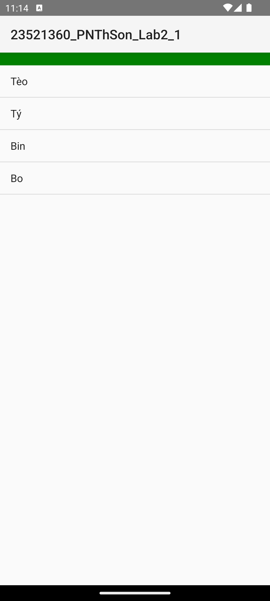 | 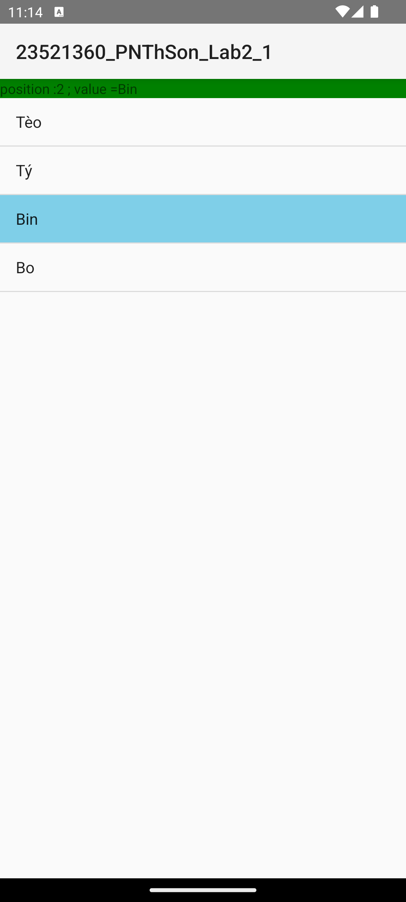 |

## Trường hợp 3: Sử dụng ArrayList và Listview control

### Code

`activity_main.xml`

```xml
<?xml version="1.0" encoding="utf-8"?>
<androidx.constraintlayout.widget.ConstraintLayout xmlns:android="http://schemas.android.com/apk/res/android"
    xmlns:app="http://schemas.android.com/apk/res-auto"
    android:layout_width="match_parent"
    android:layout_height="match_parent">

    <TextView
        android:id="@+id/tv_label"
        android:layout_width="wrap_content"
        android:layout_height="wrap_content"
        android:background="@color/label_bg"
        android:text="@string/label_name"
        app:layout_constraintBaseline_toBaselineOf="@id/et_name"
        app:layout_constraintStart_toStartOf="parent" />

    <EditText
        android:id="@+id/et_name"
        android:layout_width="0dp"
        android:layout_height="wrap_content"
        android:layout_marginStart="8dp"
        android:layout_marginEnd="16dp"
        android:inputType="text"
        app:layout_constraintEnd_toEndOf="parent"
        app:layout_constraintStart_toEndOf="@id/tv_label"
        app:layout_constraintTop_toTopOf="parent" />

    <Button
        android:id="@+id/btn_submit"
        android:layout_width="0dp"
        android:layout_height="wrap_content"
        android:text="@string/submit"
        app:layout_constraintEnd_toEndOf="@id/et_name"
        app:layout_constraintStart_toStartOf="@id/et_name"
        app:layout_constraintTop_toBottomOf="@id/et_name" />

    <TextView
        android:id="@+id/tv_selection"
        android:layout_width="0dp"
        android:layout_height="wrap_content"
        android:layout_marginTop="8dp"
        android:background="@color/selection_bg"
        app:layout_constraintEnd_toEndOf="parent"
        app:layout_constraintStart_toStartOf="parent"
        app:layout_constraintTop_toBottomOf="@id/btn_submit" />

    <ListView
        android:id="@+id/lv_person"
        android:layout_width="0dp"
        android:layout_height="0dp"
        android:background="@color/list_bg"
        android:choiceMode="singleChoice"
        app:layout_constraintBottom_toBottomOf="parent"
        app:layout_constraintEnd_toEndOf="parent"
        app:layout_constraintStart_toStartOf="parent"
        app:layout_constraintTop_toBottomOf="@id/tv_selection" />

</androidx.constraintlayout.widget.ConstraintLayout>
```

`MainActivity.java`

```java
    EditText etName;
    Button btnSubmit;
    TextView tvSelection;
    ListView lvPerson;
    ArrayList<String> names;
    ArrayAdapter<String> adapter;

    @Override
    protected void onCreate(Bundle savedInstanceState) {
        super.onCreate(savedInstanceState);
        setContentView(R.layout.activity_main);

        etName = (EditText) findViewById(R.id.et_name);
        btnSubmit = (Button) findViewById(R.id.btn_submit);
        tvSelection = (TextView) findViewById(R.id.tv_selection);
        lvPerson = (ListView) findViewById(R.id.lv_person);

        names = new ArrayList<String>();
        adapter = new ArrayAdapter<String>(this,
                android.R.layout.simple_list_item_activated_1, names);
        lvPerson.setAdapter(adapter);

        btnSubmit.setOnClickListener(new View.OnClickListener() {
            public void onClick(View arg0) {
                names.add(etName.getText().toString());
                adapter.notifyDataSetChanged();
            }
        });

        lvPerson.setOnItemClickListener(new AdapterView.OnItemClickListener() {
            public void onItemClick(AdapterView<?> arg0, View arg1, int arg2, long arg3) {
                tvSelection.setText("position : " + arg2 + "; value =" + names.get(arg2));
            }
        });

        lvPerson.setOnItemLongClickListener(new AdapterView.OnItemLongClickListener() {
            public boolean onItemLongClick(AdapterView<?> arg0, View arg1, int arg2, long arg3) {
                names.remove(arg2);
                lvPerson.clearChoices();
                adapter.notifyDataSetChanged();
                return true;
            }
        });
```

`themes.xml`

```xml
<resources>
    <style name="Theme.Lab2_3" parent="Theme.AppCompat.DayNight">
        <item name="colorControlActivated">#FF5FB6E0</item>
    </style>
</resources>
```

### Nhận xét

- `names` là danh sách lưu các tên đã nhập, `ArrayAdapter` đưa danh sách này lên `ListView`. Mỗi lần thêm hoặc xóa tên, gọi `notifyDataSetChanged()` để `ListView` cập nhật theo.
- Nút "Nhập" lấy chữ trong ô nhập rồi thêm vào `names`.
- Bấm vào một tên: `arg2` là vị trí của tên đó, dùng để lấy tên từ `names` và hiển thị lên `tvSelection`.
- Giữ lâu vào một tên: `names.remove(arg2)` xóa tên đó khỏi danh sách. `clearChoices()` bỏ màu tô của dòng đã chọn để màu không nằm nhầm sang tên khác sau khi các dòng dồn lên.
- Giao diện dùng widget gốc của Android, bố trí theo hình mẫu.

### Kết quả

| Khi mở app | Nhập teo, ty, bin |
|---|---|
| 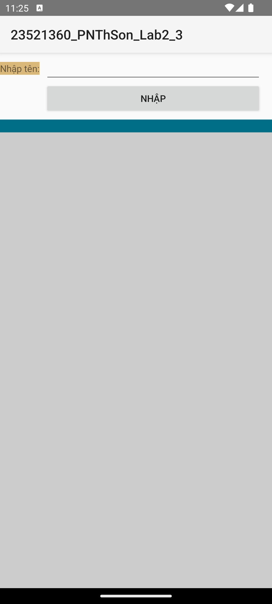 | 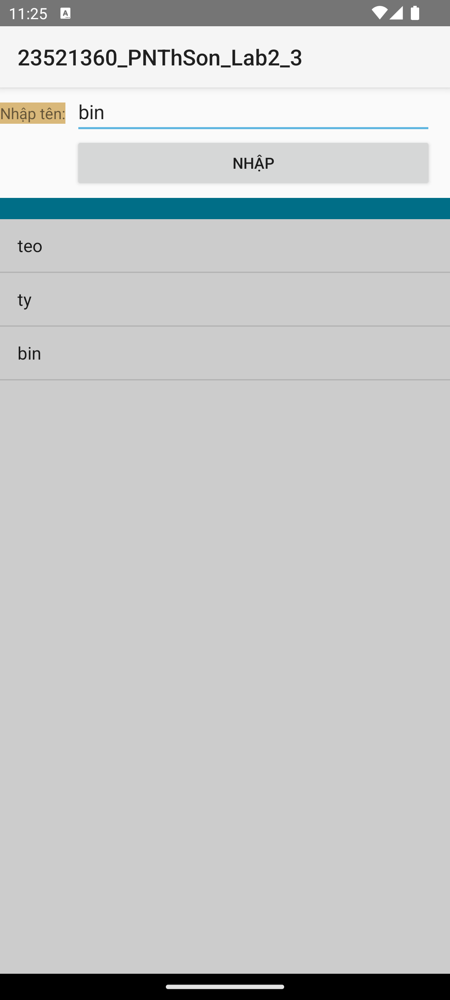 |

| Bấm vào "ty" | Giữ lâu vào "teo" để xóa |
|---|---|
| 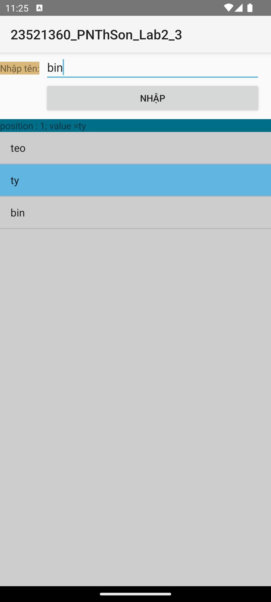 | 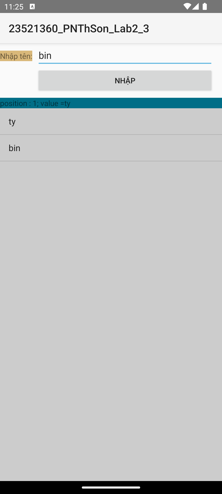 |

## Trường hợp 4: Sử dụng ArrayList và ListView mà từng phần tử trong ArrayList là các Object bất kỳ

### Code

`Employee.java`

```java
public abstract class Employee {
    private String id;
    private String name;

    public String getId() {
        return id;
    }

    public void setId(String id) {
        this.id = id;
    }

    public String getName() {
        return name;
    }

    public void setName(String name) {
        this.name = name;
    }

    public abstract double tinhLuong();

    @Override
    public String toString() {
        return id + " - " + name;
    }
}
```

`EmployeeFulltime.java`

```java
public class EmployeeFulltime extends Employee {
    @Override
    public double tinhLuong() {
        return 500;
    }

    @Override
    public String toString() {
        return super.toString() + " -->FullTime=" + tinhLuong();
    }
}
```

`EmployeeParttime.java`

```java
public class EmployeeParttime extends Employee {
    @Override
    public double tinhLuong() {
        return 150;
    }

    @Override
    public String toString() {
        return super.toString() + " -->PartTime=" + tinhLuong();
    }
}
```

`MainActivity.java`

```java
    EditText etId;
    EditText etName;
    RadioGroup rgType;
    ArrayList<Employee> employees;
    ArrayAdapter<Employee> adapter;

    @Override
    protected void onCreate(Bundle savedInstanceState) {
        super.onCreate(savedInstanceState);
        setContentView(R.layout.activity_main);

        etId = (EditText) findViewById(R.id.et_id);
        etName = (EditText) findViewById(R.id.et_name);
        rgType = (RadioGroup) findViewById(R.id.rg_type);
        Button btnNhap = (Button) findViewById(R.id.btn_nhap);
        ListView lvEmployee = (ListView) findViewById(R.id.lv_employee);

        employees = new ArrayList<Employee>();
        adapter = new ArrayAdapter<Employee>(this,
                android.R.layout.simple_list_item_1, employees);
        lvEmployee.setAdapter(adapter);

        btnNhap.setOnClickListener(new View.OnClickListener() {
            public void onClick(View arg0) {
                addNewEmployee();
            }
        });
    }

    public void addNewEmployee() {
        int radId = rgType.getCheckedRadioButtonId();
        String id = etId.getText().toString();
        String name = etName.getText().toString();
        Employee employee;
        if (radId == R.id.rd_chinhthuc) {
            employee = new EmployeeFulltime();
        } else {
            employee = new EmployeeParttime();
        }
        employee.setId(id);
        employee.setName(name);
        employees.add(employee);
        adapter.notifyDataSetChanged();
    }
```

`activity_main.xml`

```xml
<?xml version="1.0" encoding="utf-8"?>
<LinearLayout xmlns:android="http://schemas.android.com/apk/res/android"
    android:layout_width="match_parent"
    android:layout_height="match_parent"
    android:orientation="vertical">

    <TextView
        android:layout_width="match_parent"
        android:layout_height="wrap_content"
        android:background="@color/green"
        android:gravity="center"
        android:text="@string/title"
        android:textColor="@color/white"
        android:textSize="20sp" />

    <TableLayout
        android:layout_width="match_parent"
        android:layout_height="wrap_content"
        android:stretchColumns="1">

        <TableRow>
            <TextView android:text="@string/label_id" />
            <EditText
                android:id="@+id/et_id"
                android:inputType="text" />
        </TableRow>

        <TableRow>
            <TextView android:text="@string/label_name" />
            <EditText
                android:id="@+id/et_name"
                android:inputType="text" />
        </TableRow>

        <TableRow>
            <TextView android:text="@string/label_type" />
            <RadioGroup
                android:id="@+id/rg_type"
                android:orientation="horizontal">
                <RadioButton
                    android:id="@+id/rd_chinhthuc"
                    android:text="@string/full_time" />
                <RadioButton
                    android:id="@+id/rd_thoivu"
                    android:text="@string/part_time" />
            </RadioGroup>
        </TableRow>

        <TableRow>
            <Button
                android:id="@+id/btn_nhap"
                android:layout_column="1"
                android:text="@string/add" />
        </TableRow>
    </TableLayout>

    <View
        android:layout_width="match_parent"
        android:layout_height="16dp"
        android:background="@color/green" />

    <ListView
        android:id="@+id/lv_employee"
        android:layout_width="match_parent"
        android:layout_height="match_parent" />

</LinearLayout>
```

### Nhận xét

- `Employee` là lớp chung, lưu mã và tên nhân viên. `EmployeeFulltime` và `EmployeeParttime` kế thừa từ `Employee`, mỗi lớp tự tính lương theo cách riêng trong `tinhLuong()` (500 và 150).
- `toString()` của mỗi lớp lấy phần chung `mã - tên` từ `Employee`, rồi thêm phần riêng (`-->FullTime=500.0` hoặc `-->PartTime=150.0`). `ArrayAdapter` gọi `toString()` để hiển thị mỗi nhân viên thành một dòng.
- `addNewEmployee()` kiểm tra radio nào đang được chọn: "Chính thức" thì tạo `EmployeeFulltime`, ngược lại tạo `EmployeeParttime`. Cả hai đều là `Employee` nên cùng được gán mã, tên và cùng được thêm vào `employees`.
- `employees` chứa các `Employee`, nên chứa lẫn cả hai loại nhân viên trong cùng một danh sách. Mỗi nhân viên vẫn hiện đúng thông tin của loại mình.
- Giao diện dùng widget gốc của Android, bố trí theo hình mẫu.

### Kết quả

| Khi mở app | Sau khi nhập 4 nhân viên |
|---|---|
| 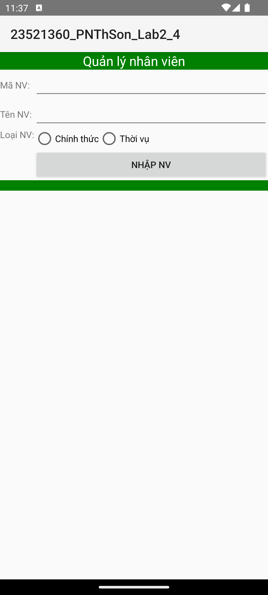 | 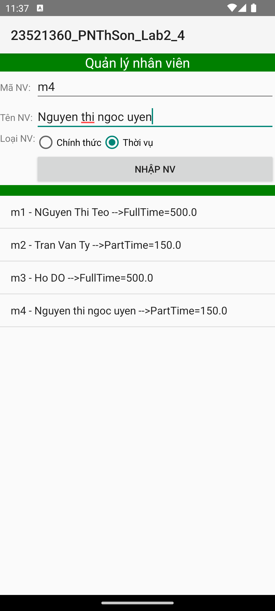 |

## Trường hợp 5: Sử dụng CustomAdapter cho Listview

### Code

`Employee.java`

```java
public class Employee {
    private String id;
    private String fullName;
    private boolean manager;

    public Employee(String id, String fullName, boolean manager) {
        this.id = id;
        this.fullName = fullName;
        this.manager = manager;
    }

    public String getId() {
        return id;
    }

    public String getFullName() {
        return fullName;
    }

    public boolean isManager() {
        return manager;
    }
}
```

`EmployeeAdapter.java`

```java
public class EmployeeAdapter extends ArrayAdapter<Employee> {
    private Activity context;

    public EmployeeAdapter(Activity context, int layoutID, List<Employee> objects) {
        super(context, layoutID, objects);
        this.context = context;
    }

    @Override
    public View getView(final int position, View convertView, ViewGroup parent) {
        if (convertView == null) {
            convertView = LayoutInflater.from(context).inflate(R.layout.item_employee, null, false);
        }

        Employee employee = getItem(position);

        TextView tvFullName = (TextView) convertView.findViewById(R.id.item_employee_tv_fullname);
        TextView tvPosition = (TextView) convertView.findViewById(R.id.item_employee_tv_position);
        ImageView ivManager = (ImageView) convertView.findViewById(R.id.item_employee_iv_manager);
        LinearLayout llParent = (LinearLayout) convertView.findViewById(R.id.item_employee_ll_parent);

        tvFullName.setText(employee.getFullName());

        if (employee.isManager()) {
            ivManager.setVisibility(View.VISIBLE);
            tvPosition.setVisibility(View.GONE);
        } else {
            ivManager.setVisibility(View.GONE);
            tvPosition.setVisibility(View.VISIBLE);
            tvPosition.setText(context.getString(R.string.staff));
        }

        if (position % 2 == 0) {
            llParent.setBackgroundResource(R.color.white);
        } else {
            llParent.setBackgroundResource(R.color.light_blue);
        }

        return convertView;
    }
}
```

`MainActivity.java`

```java
    @Override
    protected void onCreate(Bundle savedInstanceState) {
        super.onCreate(savedInstanceState);
        setContentView(R.layout.activity_main);

        final EditText etId = (EditText) findViewById(R.id.et_id);
        final EditText etFullName = (EditText) findViewById(R.id.et_full_name);
        final CheckBox cbManager = (CheckBox) findViewById(R.id.cb_manager);
        Button btnAdd = (Button) findViewById(R.id.btn_add);
        ListView lvEmployee = (ListView) findViewById(R.id.lv_employee);

        final ArrayList<Employee> employees = new ArrayList<Employee>();
        final EmployeeAdapter adapter = new EmployeeAdapter(this, R.layout.item_employee, employees);
        lvEmployee.setAdapter(adapter);

        btnAdd.setOnClickListener(new View.OnClickListener() {
            public void onClick(View arg0) {
                employees.add(new Employee(etId.getText().toString(),
                        etFullName.getText().toString(), cbManager.isChecked()));
                adapter.notifyDataSetChanged();
            }
        });
    }
```

`item_employee.xml`

```xml
<?xml version="1.0" encoding="utf-8"?>
<LinearLayout xmlns:android="http://schemas.android.com/apk/res/android"
    android:id="@+id/item_employee_ll_parent"
    android:layout_width="match_parent"
    android:layout_height="wrap_content"
    android:minHeight="58dp"
    android:paddingStart="5dp"
    android:orientation="horizontal">

    <TextView
        android:id="@+id/item_employee_tv_fullname"
        android:layout_width="0dp"
        android:layout_height="wrap_content"
        android:layout_gravity="center_vertical"
        android:layout_weight="1"
        android:ellipsize="end"
        android:singleLine="true" />

    <TextView
        android:id="@+id/item_employee_tv_position"
        android:layout_width="50dp"
        android:layout_height="wrap_content"
        android:layout_gravity="center_vertical"
        android:singleLine="true" />

    <ImageView
        android:id="@+id/item_employee_iv_manager"
        android:layout_width="50dp"
        android:layout_height="50dp"
        android:layout_gravity="center_vertical"
        android:scaleType="centerCrop"
        android:src="@drawable/ic_manager"
        android:visibility="gone" />
</LinearLayout>
```

`activity_main.xml`

```xml
<?xml version="1.0" encoding="utf-8"?>
<LinearLayout xmlns:android="http://schemas.android.com/apk/res/android"
    android:layout_width="match_parent"
    android:layout_height="match_parent"
    android:orientation="vertical">

    <TableLayout
        android:layout_width="match_parent"
        android:layout_height="wrap_content"
        android:padding="5dp"
        android:stretchColumns="1">

        <TableRow>
            <TextView android:text="@string/id" />
            <EditText
                android:id="@+id/et_id"
                android:inputType="text" />
        </TableRow>

        <TableRow>
            <TextView android:text="@string/full_name" />
            <EditText
                android:id="@+id/et_full_name"
                android:inputType="text" />
        </TableRow>

        <TableRow>
            <TextView android:text="@string/is_manager" />
            <CheckBox android:id="@+id/cb_manager" />
        </TableRow>
    </TableLayout>

    <Button
        android:id="@+id/btn_add"
        android:layout_width="wrap_content"
        android:layout_height="wrap_content"
        android:layout_gravity="center_horizontal"
        android:text="@string/add" />

    <ListView
        android:id="@+id/lv_employee"
        android:layout_width="match_parent"
        android:layout_height="match_parent"
        android:divider="@null" />

</LinearLayout>
```

### Nhận xét

- `item_employee.xml` là giao diện của một dòng trong danh sách, gồm tên nhân viên, chữ "Staff" và icon manager.
- `EmployeeAdapter` thay cho `ArrayAdapter` mặc định. Hàm `getView()` được gọi cho mỗi dòng: gán tên nhân viên; nếu là manager thì hiện icon và ẩn chữ "Staff", ngược lại thì hiện "Staff" và ẩn icon.
- Dòng ở vị trí chẵn có nền trắng, dòng ở vị trí lẻ có nền xanh nhạt, nên hai dòng liên tiếp luôn khác màu.
- Khi bấm "Add", ứng dụng tạo một `Employee` từ ID, tên và ô "Is A Manager", thêm vào `employees` rồi gọi `notifyDataSetChanged()` để danh sách cập nhật.
- Giao diện dùng widget gốc của Android, bố trí theo hình mẫu.

### Kết quả

| Khi mở app | Sau khi thêm 4 nhân viên |
|---|---|
| 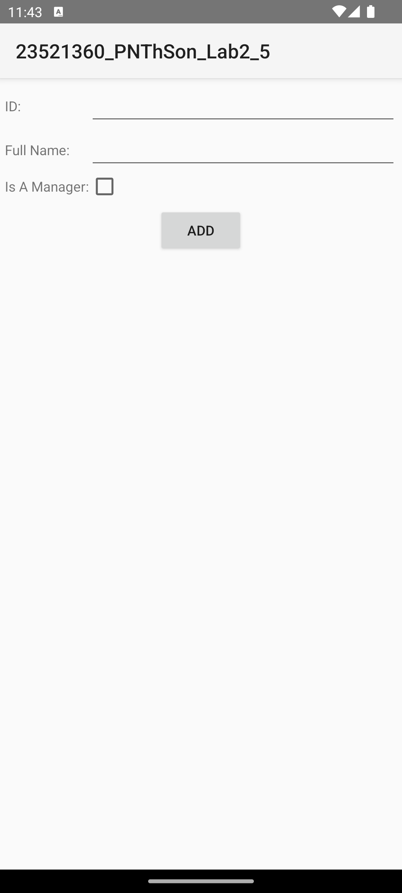 | 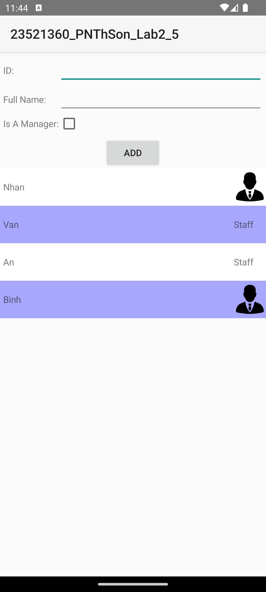 |

## Sử dụng GridView, Spinner

### Code

`Thumbnail.java`

```java
public enum Thumbnail {
    Thumbnail1("Thumbnail 1", R.drawable.first_thumbnail),
    Thumbnail2("Thumbnail 2", R.drawable.second_thumbnail),
    Thumbnail3("Thumbnail 3", R.drawable.third_thumbnail),
    Thumbnail4("Thumbnail 4", R.drawable.fourth_thumbnail);

    private String name;
    private int img;

    Thumbnail(String name, int img) {
        this.name = name;
        this.img = img;
    }

    public String getName() {
        return name;
    }

    public int getImg() {
        return img;
    }
}
```

`Dish.java`

```java
public class Dish {
    private String name;
    private Thumbnail thumbnail;
    private boolean promotion;

    public Dish(String name, Thumbnail thumbnail, boolean promotion) {
        this.name = name;
        this.thumbnail = thumbnail;
        this.promotion = promotion;
    }

    public String getName() {
        return name;
    }

    public Thumbnail getThumbnail() {
        return thumbnail;
    }

    public boolean isPromotion() {
        return promotion;
    }
}
```

`DishAdapter.java`

```java
public class DishAdapter extends ArrayAdapter<Dish> {
    private Activity context;

    public DishAdapter(Activity context, List<Dish> objects) {
        super(context, 0, objects);
        this.context = context;
    }

    @Override
    public View getView(int position, View convertView, ViewGroup parent) {
        if (convertView == null) {
            convertView = LayoutInflater.from(context).inflate(R.layout.item_dish, parent, false);
        }

        Dish dish = getItem(position);

        ImageView ivThumbnail = (ImageView) convertView.findViewById(R.id.item_dish_iv_thumbnail);
        TextView tvName = (TextView) convertView.findViewById(R.id.item_dish_tv_name);
        ImageView ivStar = (ImageView) convertView.findViewById(R.id.item_dish_iv_star);

        ivThumbnail.setImageResource(dish.getThumbnail().getImg());
        tvName.setText(dish.getName());
        tvName.setSelected(true);

        if (dish.isPromotion()) {
            ivStar.setVisibility(View.VISIBLE);
        } else {
            ivStar.setVisibility(View.GONE);
        }

        return convertView;
    }
}
```

`ThumbnailAdapter.java`

```java
public class ThumbnailAdapter extends ArrayAdapter<Thumbnail> {
    private Activity context;

    public ThumbnailAdapter(Activity context, Thumbnail[] objects) {
        super(context, 0, objects);
        this.context = context;
    }

    @Override
    public View getView(int position, View convertView, ViewGroup parent) {
        View view = LayoutInflater.from(context).inflate(R.layout.item_selected_thumbnail, parent, false);
        TextView tvName = (TextView) view.findViewById(R.id.item_selected_thumbnail_tv_name);
        tvName.setText(getItem(position).getName());
        return view;
    }

    @Override
    public View getDropDownView(int position, View convertView, ViewGroup parent) {
        View view = LayoutInflater.from(context).inflate(R.layout.item_thumbnail, parent, false);
        TextView tvName = (TextView) view.findViewById(R.id.item_thumbnail_tv_name);
        ImageView ivThumbnail = (ImageView) view.findViewById(R.id.item_thumbnail_iv_thumbnail);
        tvName.setText(getItem(position).getName());
        ivThumbnail.setImageResource(getItem(position).getImg());
        return view;
    }
}
```

`MainActivity.java`

```java
    @Override
    protected void onCreate(Bundle savedInstanceState) {
        super.onCreate(savedInstanceState);
        setContentView(R.layout.activity_main);

        final EditText etName = (EditText) findViewById(R.id.et_name);
        final Spinner spThumbnail = (Spinner) findViewById(R.id.sp_thumbnail);
        final CheckBox cbPromotion = (CheckBox) findViewById(R.id.cb_promotion);
        Button btnAdd = (Button) findViewById(R.id.btn_add);
        GridView gvDish = (GridView) findViewById(R.id.gv_dish);

        spThumbnail.setAdapter(new ThumbnailAdapter(this, Thumbnail.values()));

        final ArrayList<Dish> dishes = new ArrayList<Dish>();
        final DishAdapter adapter = new DishAdapter(this, dishes);
        gvDish.setAdapter(adapter);

        btnAdd.setOnClickListener(new View.OnClickListener() {
            public void onClick(View arg0) {
                dishes.add(new Dish(etName.getText().toString(),
                        (Thumbnail) spThumbnail.getSelectedItem(), cbPromotion.isChecked()));
                adapter.notifyDataSetChanged();

                etName.setText("");
                spThumbnail.setSelection(0);
                cbPromotion.setChecked(false);
                Toast.makeText(MainActivity.this, R.string.added, Toast.LENGTH_SHORT).show();
            }
        });
    }
```

`activity_main.xml`

```xml
<?xml version="1.0" encoding="utf-8"?>
<LinearLayout xmlns:android="http://schemas.android.com/apk/res/android"
    android:layout_width="match_parent"
    android:layout_height="match_parent"
    android:orientation="vertical">

    <TableLayout
        android:layout_width="match_parent"
        android:layout_height="wrap_content"
        android:padding="5dp"
        android:stretchColumns="1">

        <TableRow>
            <TextView android:text="@string/name" />
            <EditText
                android:id="@+id/et_name"
                android:inputType="text" />
        </TableRow>

        <TableRow>
            <TextView android:text="@string/thumbnail" />
            <Spinner
                android:id="@+id/sp_thumbnail"
                android:spinnerMode="dialog" />
        </TableRow>

        <TableRow>
            <TextView android:text="@string/promotion" />
            <CheckBox android:id="@+id/cb_promotion" />
        </TableRow>
    </TableLayout>

    <Button
        android:id="@+id/btn_add"
        android:layout_width="match_parent"
        android:layout_height="wrap_content"
        android:layout_margin="5dp"
        android:text="@string/add" />

    <GridView
        android:id="@+id/gv_dish"
        android:layout_width="match_parent"
        android:layout_height="match_parent"
        android:horizontalSpacing="1dp"
        android:numColumns="2"
        android:verticalSpacing="1dp" />

</LinearLayout>
```

`item_dish.xml`

```xml
<?xml version="1.0" encoding="utf-8"?>
<FrameLayout xmlns:android="http://schemas.android.com/apk/res/android"
    android:layout_width="match_parent"
    android:layout_height="wrap_content">

    <ImageView
        android:id="@+id/item_dish_iv_thumbnail"
        android:layout_width="match_parent"
        android:layout_height="200dp"
        android:scaleType="centerCrop" />

    <LinearLayout
        android:layout_width="match_parent"
        android:layout_height="wrap_content"
        android:layout_gravity="bottom"
        android:minHeight="40dp"
        android:background="#80000000"
        android:gravity="center_vertical"
        android:orientation="horizontal"
        android:padding="8dp">

        <TextView
            android:id="@+id/item_dish_tv_name"
            android:layout_width="0dp"
            android:layout_height="wrap_content"
            android:layout_weight="1"
            android:ellipsize="marquee"
            android:marqueeRepeatLimit="marquee_forever"
            android:singleLine="true"
            android:textColor="@color/white" />

        <ImageView
            android:id="@+id/item_dish_iv_star"
            android:layout_width="24dp"
            android:layout_height="24dp"
            android:src="@drawable/star"
            android:visibility="gone" />
    </LinearLayout>
</FrameLayout>
```

`item_thumbnail.xml`

```xml
<?xml version="1.0" encoding="utf-8"?>
<LinearLayout xmlns:android="http://schemas.android.com/apk/res/android"
    android:layout_width="match_parent"
    android:layout_height="wrap_content"
    android:gravity="center_vertical"
    android:orientation="horizontal"
    android:padding="12dp">

    <TextView
        android:id="@+id/item_thumbnail_tv_name"
        android:layout_width="0dp"
        android:layout_height="wrap_content"
        android:layout_weight="1" />

    <ImageView
        android:id="@+id/item_thumbnail_iv_thumbnail"
        android:layout_width="64dp"
        android:layout_height="48dp"
        android:scaleType="centerCrop" />
</LinearLayout>
```

`item_selected_thumbnail.xml`

```xml
<?xml version="1.0" encoding="utf-8"?>
<TextView xmlns:android="http://schemas.android.com/apk/res/android"
    android:id="@+id/item_selected_thumbnail_tv_name"
    android:layout_width="match_parent"
    android:layout_height="wrap_content"
    android:padding="8dp" />
```

### Nhận xét

- `Thumbnail` là enum gồm 4 hình có sẵn, mỗi hình có tên và ảnh. `Dish` lưu thông tin một món ăn: tên, hình và có khuyến mãi hay không.
- `ThumbnailAdapter` dành cho Spinner. `getDropDownView()` vẽ từng dòng trong danh sách chọn (tên và hình, theo `item_thumbnail.xml`), còn `getView()` chỉ vẽ tên của hình đang được chọn (theo `item_selected_thumbnail.xml`). `spinnerMode="dialog"` làm cho danh sách hiện dạng hộp thoại thay vì sổ xuống.
- `DishAdapter` dành cho GridView 2 cột (`numColumns="2"`). Mỗi ô hiển thị hình món ăn, tên món ăn, và ngôi sao nếu món có khuyến mãi (`VISIBLE` để hiện, `GONE` để ẩn). Hình dùng `centerCrop` để lấp đầy ô.
- Tên món ăn quá dài sẽ chạy ngang nhờ `ellipsize="marquee"` kết hợp `setSelected(true)`.
- Khi bấm "Add a new dish", ứng dụng thêm món vào danh sách, đưa tên về trống, hình về "Thumbnail 1", bỏ chọn Promotion rồi hiện Toast "Added successfully".
- Giao diện dùng widget gốc của Android, bố trí theo hình mẫu.

### Kết quả

| Khi mở app | Danh sách chọn hình |
|---|---|
| 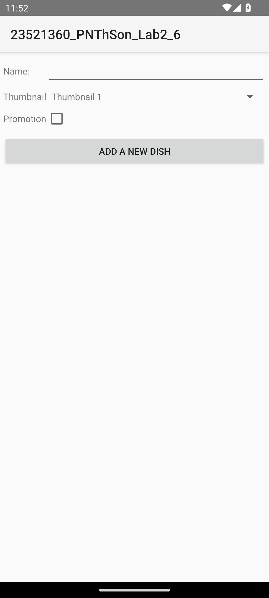 | 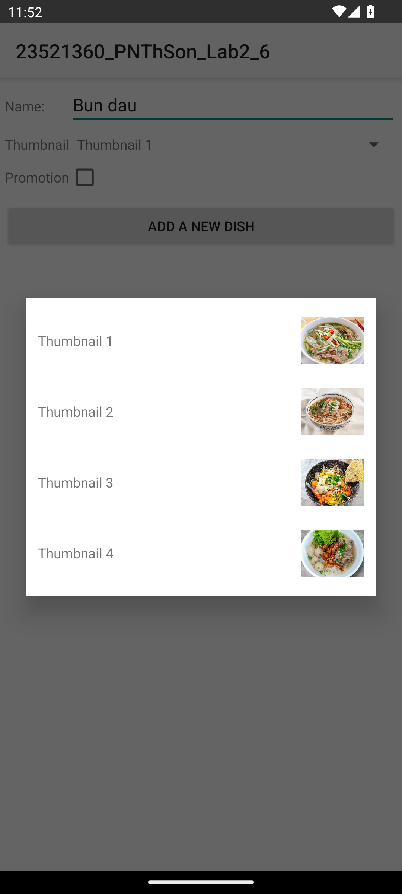 |

| Nhập tên, chọn hình, bật Promotion | Sau khi bấm Add |
|---|---|
| 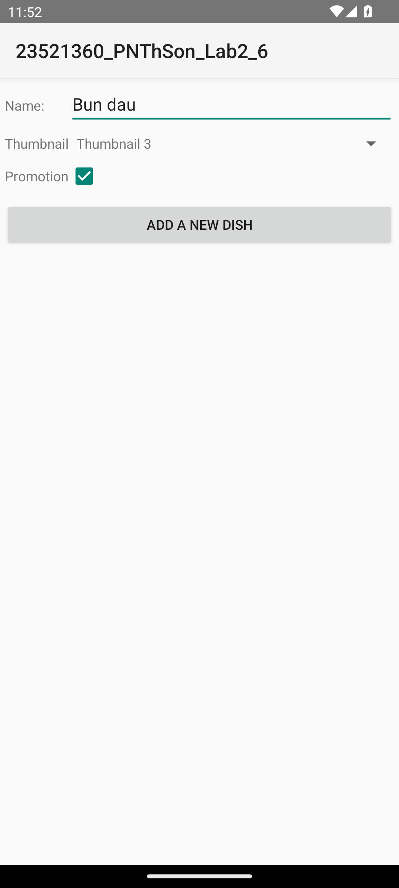 | 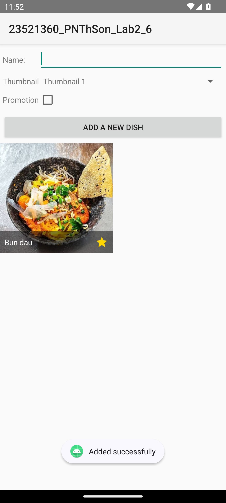 |

| Sau khi thêm 3 món (có tên dài chạy chữ) |
|---|
| 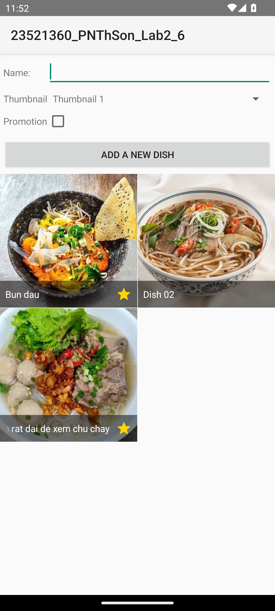 |

## RecyclerView: Làm lại Trường hợp 5 (CustomAdapter cho ListView) bằng RecyclerView

### Code

`EmployeeAdapter.java`

```java
public class EmployeeAdapter extends RecyclerView.Adapter<EmployeeAdapter.EmployeeHolder> {
    private List<Employee> employees;

    public EmployeeAdapter(List<Employee> employees) {
        this.employees = employees;
    }

    public static class EmployeeHolder extends RecyclerView.ViewHolder {
        TextView tvFullName;
        TextView tvPosition;
        ImageView ivManager;

        public EmployeeHolder(@NonNull View itemView) {
            super(itemView);
            tvFullName = (TextView) itemView.findViewById(R.id.item_employee_tv_fullname);
            tvPosition = (TextView) itemView.findViewById(R.id.item_employee_tv_position);
            ivManager = (ImageView) itemView.findViewById(R.id.item_employee_iv_manager);
        }
    }

    @NonNull
    @Override
    public EmployeeHolder onCreateViewHolder(@NonNull ViewGroup parent, int viewType) {
        View view = LayoutInflater.from(parent.getContext()).inflate(R.layout.item_employee, parent, false);
        return new EmployeeHolder(view);
    }

    @Override
    public void onBindViewHolder(@NonNull EmployeeHolder holder, int position) {
        Employee employee = employees.get(position);

        holder.tvFullName.setText(employee.getFullName());

        if (employee.isManager()) {
            holder.ivManager.setVisibility(View.VISIBLE);
            holder.tvPosition.setVisibility(View.GONE);
        } else {
            holder.ivManager.setVisibility(View.GONE);
            holder.tvPosition.setVisibility(View.VISIBLE);
            holder.tvPosition.setText(R.string.staff);
        }

        if (position % 2 == 0) {
            holder.itemView.setBackgroundResource(R.color.white);
        } else {
            holder.itemView.setBackgroundResource(R.color.light_blue);
        }
    }

    @Override
    public int getItemCount() {
        return employees.size();
    }
}
```

`MainActivity.java`

```java
    @Override
    protected void onCreate(Bundle savedInstanceState) {
        super.onCreate(savedInstanceState);
        setContentView(R.layout.activity_main);

        final EditText etId = (EditText) findViewById(R.id.et_id);
        final EditText etFullName = (EditText) findViewById(R.id.et_full_name);
        final CheckBox cbManager = (CheckBox) findViewById(R.id.cb_manager);
        Button btnAdd = (Button) findViewById(R.id.btn_add);
        RecyclerView rvEmployee = (RecyclerView) findViewById(R.id.rv_employee);

        final ArrayList<Employee> employees = new ArrayList<Employee>();
        final EmployeeAdapter adapter = new EmployeeAdapter(employees);
        rvEmployee.setLayoutManager(new LinearLayoutManager(this));
        rvEmployee.setAdapter(adapter);

        btnAdd.setOnClickListener(new View.OnClickListener() {
            public void onClick(View arg0) {
                employees.add(new Employee(etId.getText().toString(),
                        etFullName.getText().toString(), cbManager.isChecked()));
                adapter.notifyDataSetChanged();
            }
        });
    }
```

`activity_main.xml` (chỉ thay `ListView` bằng `RecyclerView`)

```xml
    <androidx.recyclerview.widget.RecyclerView
        android:id="@+id/rv_employee"
        android:layout_width="match_parent"
        android:layout_height="match_parent" />
```

### Nhận xét

- ListView dùng một hàm `getView()` cho mỗi dòng. RecyclerView chia việc thành hai hàm: `onCreateViewHolder()` tạo dòng, còn `onBindViewHolder()` đưa dữ liệu của nhân viên lên dòng đó.
- `EmployeeHolder` giữ sẵn tên, chữ "Staff" và icon của một dòng. Nhờ vậy khi cuộn danh sách, không phải tìm lại các thành phần này nhiều lần.
- RecyclerView cần `LinearLayoutManager` để biết xếp các dòng theo chiều dọc, giống ListView.
- Cách hiển thị giữ nguyên như Trường hợp 5: manager hiện icon, nhân viên thường hiện "Staff", dòng chẵn và lẻ có nền khác nhau.
- Nút "Add" vẫn thêm `Employee` vào danh sách rồi gọi `notifyDataSetChanged()`.

### Kết quả

Giao diện và kết quả giống Trường hợp 5.
