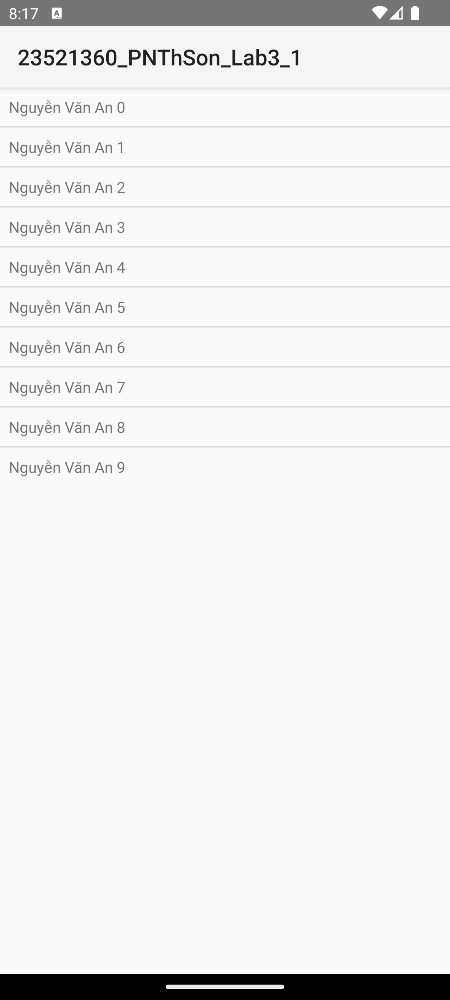
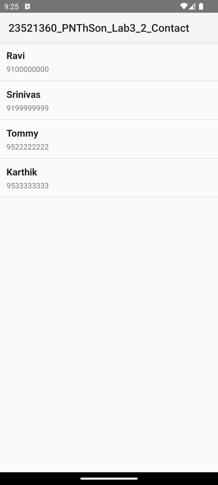
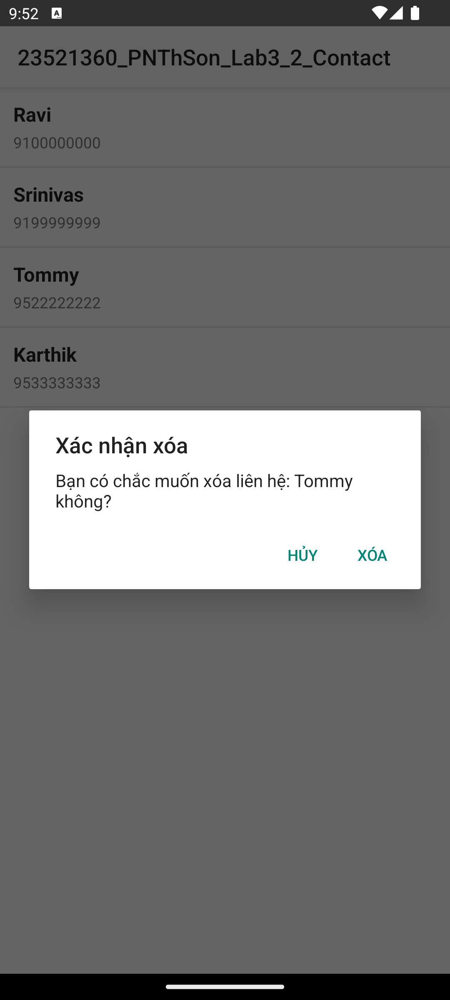
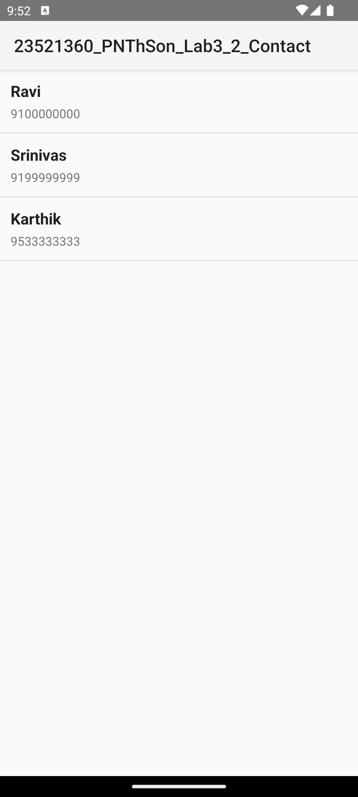
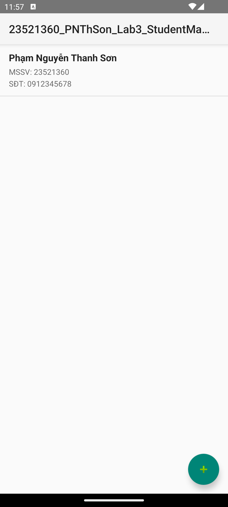
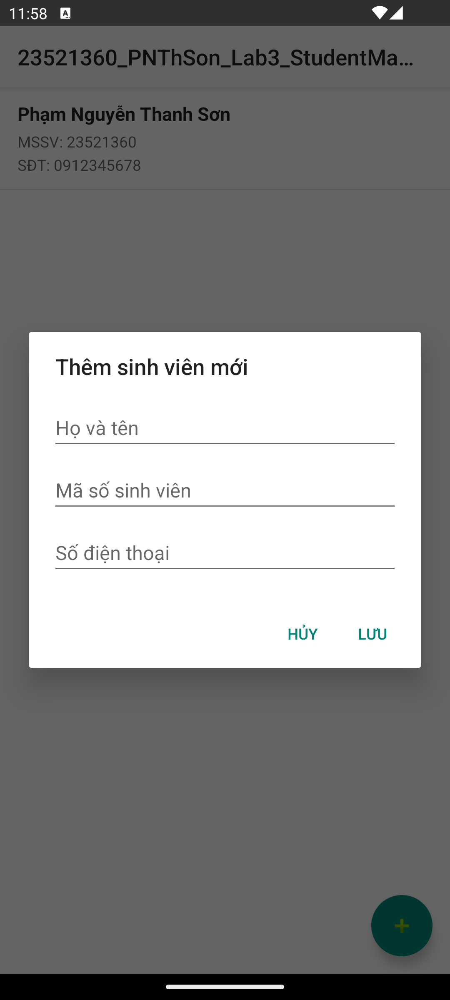
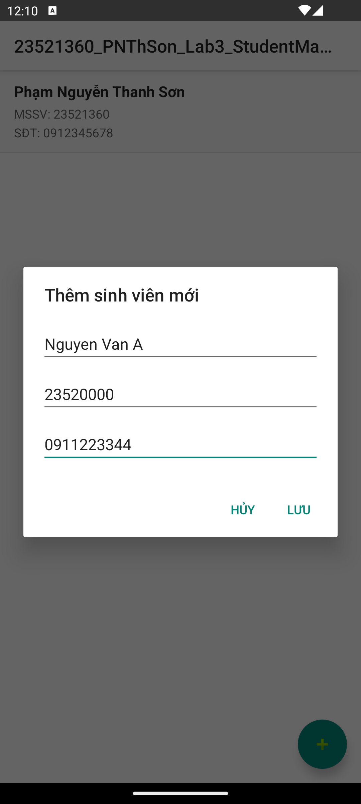
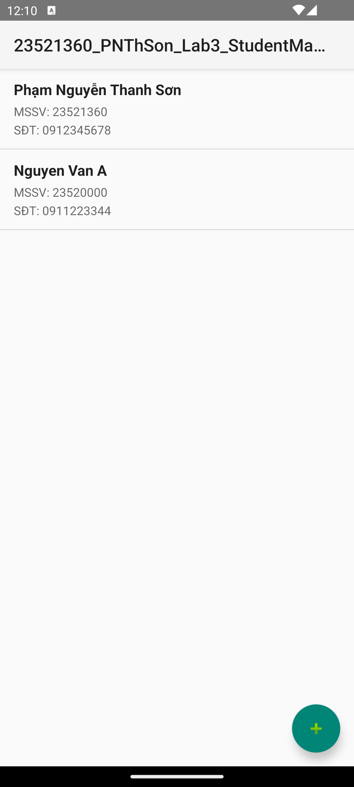
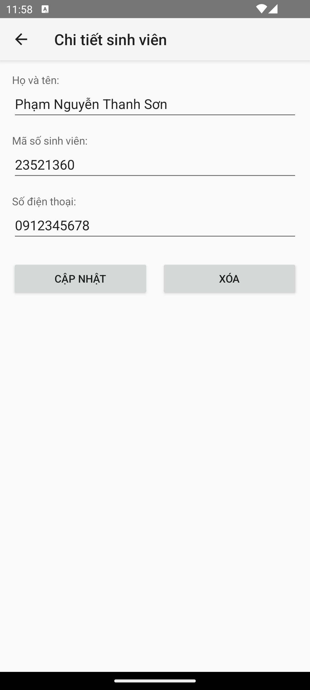
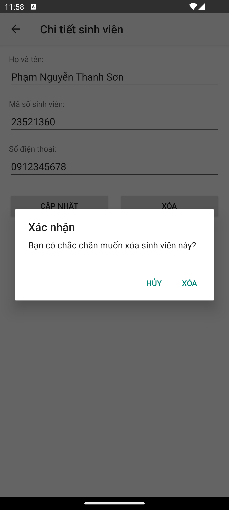

Lớp: NT118.R12.1
Họ và tên: Phạm Nguyễn Thanh Sơn
MSSV: 23521360

# Lab3 CƠ SỞ DỮ LIỆU SQLITE

## I. [Tham khảo] Tạo 1 CSDL SQLite, thêm vào CSDL danh sách các user, sau đó lấy dữ liệu từ CSDL hiện lên listview

### Code

`activity_main.xml`

```xml
<?xml version="1.0" encoding="utf-8"?>
<LinearLayout xmlns:android="http://schemas.android.com/apk/res/android"
    android:layout_width="match_parent"
    android:layout_height="match_parent"
    android:orientation="vertical">

    <ListView
        android:id="@+id/lv_user"
        android:layout_width="wrap_content"
        android:layout_height="wrap_content" />

</LinearLayout>
```

`item_user.xml`

```xml
<?xml version="1.0" encoding="utf-8"?>
<TextView xmlns:android="http://schemas.android.com/apk/res/android"
    android:id="@+id/tv_user"
    android:layout_width="match_parent"
    android:layout_height="wrap_content"
    android:padding="8dp" />
```

`DatabaseHelper.java`

```java
public class DatabaseHelper extends SQLiteOpenHelper {
    private static final String DATABASE_CREATE =
            "CREATE TABLE users (_id INTEGER PRIMARY KEY AUTOINCREMENT, name TEXT NOT NULL);";

    public DatabaseHelper(Context context, String name, SQLiteDatabase.CursorFactory factory, int version) {
        super(context, name, factory, version);
    }

    @Override
    public void onCreate(SQLiteDatabase db) {
        db.execSQL(DATABASE_CREATE);
    }

    @Override
    public void onUpgrade(SQLiteDatabase db, int oldVersion, int newVersion) {
        db.execSQL("DROP TABLE IF EXISTS users");
        onCreate(db);
    }
}
```

`DbAdapter.java`

```java
public class DbAdapter {
    public static final String KEY_ID = "_id";
    public static final String KEY_NAME = "name";

    private DatabaseHelper dbHelper;
    private SQLiteDatabase sqLiteDatabase;

    private static final String DATABASE_NAME = "Database_Demo";
    private static final String DATABASE_TABLE = "users";
    private static final int DATABASE_VERSION = 2;

    private final Context context;

    public DbAdapter(Context ctx) {
        this.context = ctx;
    }

    public DbAdapter open() {
        dbHelper = new DatabaseHelper(context, DATABASE_NAME, null, DATABASE_VERSION);
        sqLiteDatabase = dbHelper.getWritableDatabase();
        return this;
    }

    public void close() {
        if (dbHelper != null) {
            dbHelper.close();
        }
    }

    public long createUser(String name) {
        ContentValues initialValues = new ContentValues();
        initialValues.put(KEY_NAME, name);
        return sqLiteDatabase.insert(DATABASE_TABLE, null, initialValues);
    }

    public boolean deleteAllUsers() {
        return sqLiteDatabase.delete(DATABASE_TABLE, null, null) > 0;
    }

    public Cursor getAllUsers() {
        return sqLiteDatabase.query(DATABASE_TABLE, new String[]{KEY_ID, KEY_NAME},
                null, null, null, null, null);
    }
}
```

`MainActivity.java`

```java
        setTitle("23521360_PNThSon_Lab3_1");

        dbAdapter = new DbAdapter(this);
        dbAdapter.open();

        dbAdapter.deleteAllUsers();

        for (int i = 0; i < 10; i++) {
            dbAdapter.createUser("Nguyễn Văn An " + i);
        }

        users = getData();

        showData();
```

```java
    private List<String> getData() {
        List<String> list = new ArrayList<>();
        cursor = dbAdapter.getAllUsers();

        if (cursor != null) {
            while (cursor.moveToNext()) {
                int nameColumnIndex = cursor.getColumnIndex(DbAdapter.KEY_NAME);
                if (nameColumnIndex != -1) {
                    list.add(cursor.getString(nameColumnIndex));
                }
            }
            cursor.close();
        }
        return list;
    }

    private void showData() {
        ListView lvUser = findViewById(R.id.lv_user);

        ArrayAdapter<String> userAdapter = new ArrayAdapter<>(
                MainActivity.this,
                R.layout.item_user,
                R.id.tv_user,
                users
        );
        lvUser.setAdapter(userAdapter);
    }

    @Override
    protected void onDestroy() {
        super.onDestroy();
        if (dbAdapter != null) {
            dbAdapter.close();
        }
    }
```

### Nhận xét

- Lớp DatabaseHelper kế thừa SQLiteOpenHelper để quản lý việc khởi tạo và nâng cấp cơ sở dữ liệu Database_Demo. Câu lệnh SQL tạo bảng users có hai cột gồm _id tự tăng làm khóa chính và name lưu tên người dùng.
- Phương thức onCreate được gọi tự động khi cơ sở dữ liệu chưa tồn tại để thực thi câu lệnh tạo bảng. Phương thức onUpgrade chạy khi phiên bản cơ sở dữ liệu được nâng lên, thực hiện xóa bảng cũ và gọi lại onCreate.
- Lớp DbAdapter đóng gói các phương thức thao tác trực tiếp với bảng users để tách biệt logic cơ sở dữ liệu khỏi giao diện. Phương thức open mở cơ sở dữ liệu dưới quyền ghi writable, phương thức close đóng kết nối để giải phóng tài nguyên.
- Phương thức createUser sử dụng ContentValues đưa dữ liệu tên vào bảng qua lệnh insert. Phương thức deleteAllUsers xóa sạch các dòng dữ liệu để khởi tạo lại danh sách mới mỗi khi chạy ứng dụng.
- Phương thức getAllUsers truy vấn toàn bộ dữ liệu trong bảng users và trả về một đối tượng Cursor trỏ tới tập kết quả.
- Trong MainActivity, vòng lặp for thực hiện thêm lần lượt 10 người dùng mẫu vào cơ sở dữ liệu.
- Phương thức getData duyệt Cursor qua từng dòng bằng moveToNext, lấy giá trị của cột name thông qua vị trí index và đưa vào danh sách ArrayList. Sau khi duyệt xong, con trỏ cursor được đóng lại.
- Phương thức showData sử dụng ArrayAdapter ánh xạ danh sách chuỗi tên lên layout item_user và gắn vào ListView lv_user trên giao diện chính.
- Phương thức onDestroy được ghi đè để đảm bảo cơ sở dữ liệu luôn được đóng an toàn khi Activity kết thúc vòng đời.
- Cursor hoạt động như một con trỏ duyệt kết quả truy vấn trên bộ nhớ tạm RAM. Phương thức getColumnIndex tìm chỉ số cột theo tên để tránh lỗi chỉ số cứng khi cấu trúc bảng thay đổi.
- ContentValues lưu trữ dữ liệu dưới dạng cặp khóa và giá trị tương tự Map, giúp hệ thống tự động xử lý an toàn các ký tự đặc biệt khi sinh câu lệnh SQL chèn vào bảng.

### Kết quả

| Màn hình hiển thị danh sách user từ SQLite |
|---|
|  |


## II. [Thực hành] Quản lý Contact

### Code

`Contact.java`

```java
public class Contact {
    private int id;
    private String name;
    private String phoneNumber;

    public Contact() {}

    public Contact(String name, String phoneNumber) {
        this.name = name;
        this.phoneNumber = phoneNumber;
    }

    public Contact(int id, String name, String phoneNumber) {
        this.id = id;
        this.name = name;
        this.phoneNumber = phoneNumber;
    }

    public int getId() { return id; }
    public void setId(int id) { this.id = id; }

    public String getName() { return name; }
    public void setName(String name) { this.name = name; }

    public String getPhoneNumber() { return phoneNumber; }
    public void setPhoneNumber(String phoneNumber) { this.phoneNumber = phoneNumber; }
}
```

`DatabaseHandler.java`

```java
public class DatabaseHandler extends SQLiteOpenHelper {

    private static final int DATABASE_VERSION = 1;
    private static final String DATABASE_NAME = "contactsManager";
    private static final String TABLE_CONTACTS = "contacts";

    private static final String KEY_ID = "id";
    private static final String KEY_NAME = "name";
    private static final String KEY_PH_NO = "phone_number";

    public DatabaseHandler(Context context) {
        super(context, DATABASE_NAME, null, DATABASE_VERSION);
    }

    @Override
    public void onCreate(SQLiteDatabase db) {
        String CREATE_CONTACTS_TABLE = "CREATE TABLE " + TABLE_CONTACTS + "("
                + KEY_ID + " INTEGER PRIMARY KEY AUTOINCREMENT,"
                + KEY_NAME + " TEXT,"
                + KEY_PH_NO + " TEXT" + ")";
        db.execSQL(CREATE_CONTACTS_TABLE);
    }

    @Override
    public void onUpgrade(SQLiteDatabase db, int oldVersion, int newVersion) {
        db.execSQL("DROP TABLE IF EXISTS " + TABLE_CONTACTS);
        onCreate(db);
    }

    public void addContact(Contact contact) {
        SQLiteDatabase db = this.getWritableDatabase();
        ContentValues values = new ContentValues();
        values.put(KEY_NAME, contact.getName());
        values.put(KEY_PH_NO, contact.getPhoneNumber());

        db.insert(TABLE_CONTACTS, null, values);
        db.close();
    }

    public List<Contact> getAllContacts() {
        List<Contact> contactList = new ArrayList<>();
        String selectQuery = "SELECT * FROM " + TABLE_CONTACTS;

        SQLiteDatabase db = this.getReadableDatabase();
        Cursor cursor = db.rawQuery(selectQuery, null);

        if (cursor.moveToFirst()) {
            do {
                Contact contact = new Contact();
                contact.setId(cursor.getInt(cursor.getColumnIndexOrThrow(KEY_ID)));
                contact.setName(cursor.getString(cursor.getColumnIndexOrThrow(KEY_NAME)));
                contact.setPhoneNumber(cursor.getString(cursor.getColumnIndexOrThrow(KEY_PH_NO)));
                contactList.add(contact);
            } while (cursor.moveToNext());
        }
        cursor.close();
        db.close();
        return contactList;
    }

    public void deleteContact(Contact contact) {
        SQLiteDatabase db = this.getWritableDatabase();
        db.delete(TABLE_CONTACTS, KEY_ID + " = ?",
                new String[]{String.valueOf(contact.getId())});
        db.close();
    }

    public int getContactsCount() {
        String countQuery = "SELECT * FROM " + TABLE_CONTACTS;
        SQLiteDatabase db = this.getReadableDatabase();
        Cursor cursor = db.rawQuery(countQuery, null);
        int count = cursor.getCount();
        cursor.close();
        db.close();
        return count;
    }
}
```

`ContactAdapter.java`

```java
public class ContactAdapter extends ArrayAdapter<Contact> {

    private final Context context;
    private final int resource;
    private final List<Contact> contacts;

    public ContactAdapter(Context context, int resource, List<Contact> objects) {
        super(context, resource, objects);
        this.context = context;
        this.resource = resource;
        this.contacts = objects;
    }

    @Override
    public View getView(int position, View convertView, ViewGroup parent) {
        if (convertView == null) {
            convertView = LayoutInflater.from(context).inflate(resource, parent, false);
        }

        TextView tvName = convertView.findViewById(R.id.tv_name);
        TextView tvPhone = convertView.findViewById(R.id.tv_phone);

        Contact contact = contacts.get(position);
        if (contact != null) {
            tvName.setText(contact.getName());
            tvPhone.setText(contact.getPhoneNumber());
        }

        return convertView;
    }
}
```

`MainActivity.java`

```java
        lvContact = findViewById(R.id.lv_contact);
        db = new DatabaseHandler(this);

        if (db.getContactsCount() == 0) {
            Log.d("Insert: ", "Inserting..");
            db.addContact(new Contact("Ravi", "9100000000"));
            db.addContact(new Contact("Srinivas", "9199999999"));
            db.addContact(new Contact("Tommy", "9522222222"));
            db.addContact(new Contact("Karthik", "9533333333"));
        }

        contactList = db.getAllContacts();

        adapter = new ContactAdapter(this, R.layout.item_contact, contactList);
        lvContact.setAdapter(adapter);

        lvContact.setOnItemLongClickListener(new AdapterView.OnItemLongClickListener() {
            @Override
            public boolean onItemLongClick(AdapterView<?> parent, View view, int position, long id) {
                Contact selectedContact = contactList.get(position);
                showDeleteConfirmDialog(selectedContact, position);
                return true;
            }
        });
```

```java
    private void showDeleteConfirmDialog(final Contact contact, final int position) {
        new AlertDialog.Builder(this)
                .setTitle("Xác nhận xóa")
                .setMessage("Bạn có chắc muốn xóa liên hệ: " + contact.getName() + " không?")
                .setPositiveButton("Xóa", (dialog, which) -> {
                    db.deleteContact(contact);
                    contactList.remove(position);
                    adapter.notifyDataSetChanged();
                    Toast.makeText(MainActivity.this, "Đã xóa thành công!", Toast.LENGTH_SHORT).show();
                })
                .setNegativeButton("Hủy", null)
                .show();
    }
```

`activity_main.xml`

```xml
<?xml version="1.0" encoding="utf-8"?>
<LinearLayout xmlns:android="http://schemas.android.com/apk/res/android"
    android:layout_width="match_parent"
    android:layout_height="match_parent"
    android:orientation="vertical">

    <ListView
        android:id="@+id/lv_contact"
        android:layout_width="match_parent"
        android:layout_height="match_parent"
        android:divider="#E0E0E0"
        android:dividerHeight="1dp" />

</LinearLayout>
```

`item_contact.xml`

```xml
<?xml version="1.0" encoding="utf-8"?>
<LinearLayout xmlns:android="http://schemas.android.com/apk/res/android"
    android:layout_width="match_parent"
    android:layout_height="wrap_content"
    android:orientation="vertical"
    android:padding="12dp">

    <TextView
        android:id="@+id/tv_name"
        android:layout_width="match_parent"
        android:layout_height="wrap_content"
        android:textSize="18sp"
        android:textStyle="bold"
        android:textColor="#212121" />

    <TextView
        android:id="@+id/tv_phone"
        android:layout_width="match_parent"
        android:layout_height="wrap_content"
        android:layout_marginTop="4dp"
        android:textSize="14sp"
        android:textColor="#757575" />

</LinearLayout>
```

### Nhận xét

- Lớp Contact là mô hình dữ liệu đại diện cho một đối tượng liên hệ với ba thuộc tính id, name và phoneNumber cùng các hàm getter và setter tương ứng.
- Lớp DatabaseHandler kế thừa SQLiteOpenHelper quản lý cơ sở dữ liệu contactsManager và bảng contacts. Cột id được cấu hình tự tăng làm khóa chính để tự động phân biệt các bản ghi.
- Phương thức addContact sử dụng ContentValues chèn một đối tượng Contact mới vào bảng. Phương thức getAllContacts thực thi truy vấn lấy toàn bộ danh sách liên hệ, chuyển đổi từng dòng của Cursor thành đối tượng Contact và đóng kết nối sau khi xử lý.
- Phương thức deleteContact sử dụng câu lệnh delete dựa trên id của liên hệ được chọn để xóa chính xác bản ghi trong cơ sở dữ liệu.
- Phương thức getContactsCount đếm số lượng bản ghi hiện có trong bảng. Trong hàm onCreate của MainActivity, phương thức này dùng để kiểm tra nếu bảng đang rỗng thì mới nạp 4 liên hệ mẫu ban đầu, tránh việc dữ liệu bị nhân bản trùng lặp mỗi khi khởi động lại ứng dụng.
- Lớp tùy biến ContactAdapter kế thừa ArrayAdapter giúp ánh xạ danh sách các đối tượng Contact vào layout item_contact, hiển thị rõ ràng cả họ tên và số điện thoại trên từng dòng của ListView.
- Sự kiện onItemLongClickListener được bắt khi người dùng nhấn giữ lâu vào một dòng trong danh sách. Một hộp thoại AlertDialog xuất hiện yêu cầu người dùng xác nhận thao tác xóa.
- Khi người dùng xác nhận xóa, ứng dụng gọi deleteContact trong DatabaseHandler để xóa khỏi SQLite, đồng thời xóa đối tượng khỏi danh sách contactList trong bộ nhớ và gọi notifyDataSetChanged() để cập nhật lại giao diện ngay lập tức mà không cần tải lại toàn bộ Activity.
- Phương thức notifyDataSetChanged gửi tín hiệu đồng bộ để Adapter vẽ lại các phần tử trên màn hình, giúp giao diện phản hồi mượt mà mà không tốn chi phí nạp lại toàn bộ Activity hay truy vấn lại SQLite từ đầu.
- Phương thức getContactsCount đếm số lượng dòng trong bảng bằng rawQuery giúp tối ưu kiểm tra bảng rỗng ở thời điểm khởi động, thay vì phải tải toàn bộ danh sách đối tượng lên bộ nhớ.

### Kết quả

| Ban đầu | Nhấn giữ lâu để xóa | Sau khi xóa |
|---|---|---|
|  |  |  |


## III. Bài thực hành: Quản lý danh sách sinh viên

### Code

`Student.java`

```java
public class Student implements Serializable {
    private int id;
    private String name;
    private String studentCode;
    private String phone;

    public Student() {}

    public Student(String name, String studentCode, String phone) {
        this.name = name;
        this.studentCode = studentCode;
        this.phone = phone;
    }

    public Student(int id, String name, String studentCode, String phone) {
        this.id = id;
        this.name = name;
        this.studentCode = studentCode;
        this.phone = phone;
    }

    public int getId() { return id; }
    public void setId(int id) { this.id = id; }

    public String getName() { return name; }
    public void setName(String name) { this.name = name; }

    public String getStudentCode() { return studentCode; }
    public void setStudentCode(String studentCode) { this.studentCode = studentCode; }

    public String getPhone() { return phone; }
    public void setPhone(String phone) { this.phone = phone; }
}
```

`StudentDbHelper.java`

```java
public class StudentDbHelper extends SQLiteOpenHelper {

    private static final String DATABASE_NAME = "student_manager.db";
    private static final int DATABASE_VERSION = 1;

    private static final String TABLE_NAME = "students";
    private static final String COL_ID = "id";
    private static final String COL_NAME = "name";
    private static final String COL_CODE = "student_code";
    private static final String COL_PHONE = "phone";

    public StudentDbHelper(Context context) {
        super(context, DATABASE_NAME, null, DATABASE_VERSION);
    }

    @Override
    public void onCreate(SQLiteDatabase db) {
        String createTableQuery = "CREATE TABLE " + TABLE_NAME + " ("
                + COL_ID + " INTEGER PRIMARY KEY AUTOINCREMENT, "
                + COL_NAME + " TEXT, "
                + COL_CODE + " TEXT, "
                + COL_PHONE + " TEXT)";
        db.execSQL(createTableQuery);

        ContentValues values = new ContentValues();
        values.put(COL_NAME, "Phạm Nguyễn Thanh Sơn");
        values.put(COL_CODE, "23521360");
        values.put(COL_PHONE, "0912345678");
        db.insert(TABLE_NAME, null, values);
    }

    @Override
    public void onUpgrade(SQLiteDatabase db, int oldVersion, int newVersion) {
        db.execSQL("DROP TABLE IF EXISTS " + TABLE_NAME);
        onCreate(db);
    }

    public long insertStudent(Student student) {
        SQLiteDatabase db = this.getWritableDatabase();
        ContentValues values = new ContentValues();
        values.put(COL_NAME, student.getName());
        values.put(COL_CODE, student.getStudentCode());
        values.put(COL_PHONE, student.getPhone());
        long result = db.insert(TABLE_NAME, null, values);
        db.close();
        return result;
    }

    public List<Student> getAllStudents() {
        List<Student> list = new ArrayList<>();
        SQLiteDatabase db = this.getReadableDatabase();
        Cursor cursor = db.rawQuery("SELECT * FROM " + TABLE_NAME, null);

        if (cursor.moveToFirst()) {
            do {
                Student s = new Student(
                        cursor.getInt(cursor.getColumnIndexOrThrow(COL_ID)),
                        cursor.getString(cursor.getColumnIndexOrThrow(COL_NAME)),
                        cursor.getString(cursor.getColumnIndexOrThrow(COL_CODE)),
                        cursor.getString(cursor.getColumnIndexOrThrow(COL_PHONE))
                );
                list.add(s);
            } while (cursor.moveToNext());
        }
        cursor.close();
        db.close();
        return list;
    }

    public int updateStudent(Student student) {
        SQLiteDatabase db = this.getWritableDatabase();
        ContentValues values = new ContentValues();
        values.put(COL_NAME, student.getName());
        values.put(COL_CODE, student.getStudentCode());
        values.put(COL_PHONE, student.getPhone());
        int rows = db.update(TABLE_NAME, values, COL_ID + " = ?",
                new String[]{String.valueOf(student.getId())});
        db.close();
        return rows;
    }

    public int deleteStudent(int id) {
        SQLiteDatabase db = this.getWritableDatabase();
        int rows = db.delete(TABLE_NAME, COL_ID + " = ?",
                new String[]{String.valueOf(id)});
        db.close();
        return rows;
    }
}
```

`StudentAdapter.java`

```java
public class StudentAdapter extends RecyclerView.Adapter<StudentAdapter.StudentViewHolder> {

    public interface OnItemClickListener {
        void onItemClick(Student student);
    }

    private List<Student> studentList;
    private final OnItemClickListener listener;

    public StudentAdapter(List<Student> studentList, OnItemClickListener listener) {
        this.studentList = studentList;
        this.listener = listener;
    }

    public void updateData(List<Student> newList) {
        this.studentList = newList;
        notifyDataSetChanged();
    }

    @Override
    public StudentViewHolder onCreateViewHolder(ViewGroup parent, int viewType) {
        View view = LayoutInflater.from(parent.getContext())
                .inflate(R.layout.item_student, parent, false);
        return new StudentViewHolder(view);
    }

    @Override
    public void onBindViewHolder(StudentViewHolder holder, int position) {
        Student student = studentList.get(position);
        holder.tvName.setText(student.getName());
        holder.tvCode.setText("MSSV: " + student.getStudentCode());
        holder.tvPhone.setText("SĐT: " + student.getPhone());
        holder.itemView.setOnClickListener(v -> listener.onItemClick(student));
    }

    @Override
    public int getItemCount() {
        return studentList != null ? studentList.size() : 0;
    }

    static class StudentViewHolder extends RecyclerView.ViewHolder {
        TextView tvName, tvCode, tvPhone;

        public StudentViewHolder(View itemView) {
            super(itemView);
            tvName = itemView.findViewById(R.id.tv_student_name);
            tvCode = itemView.findViewById(R.id.tv_student_code);
            tvPhone = itemView.findViewById(R.id.tv_student_phone);
        }
    }
}
```

`MainActivity.java`

```java
        rvStudents = findViewById(R.id.rv_students);
        fabAdd = findViewById(R.id.fab_add);
        dbHelper = new StudentDbHelper(this);

        studentList = new ArrayList<>();
        adapter = new StudentAdapter(studentList, student -> {
            Intent intent = new Intent(MainActivity.this, DetailActivity.class);
            intent.putExtra("STUDENT_DATA", student);
            startActivity(intent);
        });

        rvStudents.setLayoutManager(new LinearLayoutManager(this));
        rvStudents.addItemDecoration(new DividerItemDecoration(this, DividerItemDecoration.VERTICAL));
        rvStudents.setAdapter(adapter);

        fabAdd.setOnClickListener(v -> showAddStudentDialog());
```

```java
    @Override
    protected void onResume() {
        super.onResume();
        loadStudentData();
    }

    private void loadStudentData() {
        studentList = dbHelper.getAllStudents();
        if (studentList.isEmpty()) {
            dbHelper.insertStudent(new Student("Phạm Nguyễn Thanh Sơn", "23521360", "0912345678"));
            studentList = dbHelper.getAllStudents();
        }
        adapter.updateData(studentList);
    }

    private void showAddStudentDialog() {
        View dialogView = LayoutInflater.from(this).inflate(R.layout.dialog_add_student, null);
        EditText edtName = dialogView.findViewById(R.id.edt_add_name);
        EditText edtCode = dialogView.findViewById(R.id.edt_add_code);
        EditText edtPhone = dialogView.findViewById(R.id.edt_add_phone);

        new AlertDialog.Builder(this)
                .setTitle("Thêm sinh viên mới")
                .setView(dialogView)
                .setPositiveButton("Lưu", (dialog, which) -> {
                    String name = edtName.getText().toString().trim();
                    String code = edtCode.getText().toString().trim();
                    String phone = edtPhone.getText().toString().trim();

                    if (!name.isEmpty() && !code.isEmpty()) {
                        Student student = new Student(name, code, phone);
                        dbHelper.insertStudent(student);
                        loadStudentData();
                    } else {
                        Toast.makeText(MainActivity.this, "Không được để trống Tên và MSSV", Toast.LENGTH_SHORT).show();
                    }
                })
                .setNegativeButton("Hủy", null)
                .show();
    }
```

`DetailActivity.java`

```java
        dbHelper = new StudentDbHelper(this);

        if (getSupportActionBar() != null) {
            getSupportActionBar().setTitle("Chi tiết sinh viên");
            getSupportActionBar().setDisplayHomeAsUpEnabled(true);
        }

        edtName = findViewById(R.id.edt_detail_name);
        edtCode = findViewById(R.id.edt_detail_code);
        edtPhone = findViewById(R.id.edt_detail_phone);
        btnUpdate = findViewById(R.id.btn_update);
        btnDelete = findViewById(R.id.btn_delete);

        currentStudent = (Student) getIntent().getSerializableExtra("STUDENT_DATA");

        if (currentStudent != null) {
            edtName.setText(currentStudent.getName());
            edtCode.setText(currentStudent.getStudentCode());
            edtPhone.setText(currentStudent.getPhone());
        }

        btnUpdate.setOnClickListener(v -> handleUpdate());
        btnDelete.setOnClickListener(v -> confirmDelete());
```

```java
    private void handleUpdate() {
        String name = edtName.getText().toString().trim();
        String code = edtCode.getText().toString().trim();
        String phone = edtPhone.getText().toString().trim();

        if (name.isEmpty() || code.isEmpty()) {
            Toast.makeText(this, "Vui lòng nhập tên và MSSV", Toast.LENGTH_SHORT).show();
            return;
        }

        currentStudent.setName(name);
        currentStudent.setStudentCode(code);
        currentStudent.setPhone(phone);

        dbHelper.updateStudent(currentStudent);
        Toast.makeText(this, "Đã cập nhật", Toast.LENGTH_SHORT).show();
        finish();
    }

    private void confirmDelete() {
        new AlertDialog.Builder(this)
                .setTitle("Xác nhận")
                .setMessage("Bạn có chắc chắn muốn xóa sinh viên này?")
                .setPositiveButton("Xóa", (dialog, which) -> {
                    dbHelper.deleteStudent(currentStudent.getId());
                    Toast.makeText(this, "Đã xóa sinh viên", Toast.LENGTH_SHORT).show();
                    finish();
                })
                .setNegativeButton("Hủy", null)
                .show();
    }

    @Override
    public boolean onSupportNavigateUp() {
        finish();
        return true;
    }
```

`activity_main.xml`

```xml
<?xml version="1.0" encoding="utf-8"?>
<androidx.coordinatorlayout.widget.CoordinatorLayout
    xmlns:android="http://schemas.android.com/apk/res/android"
    xmlns:app="http://schemas.android.com/apk/res-auto"
    android:layout_width="match_parent"
    android:layout_height="match_parent">

    <androidx.recyclerview.widget.RecyclerView
        android:id="@+id/rv_students"
        android:layout_width="match_parent"
        android:layout_height="match_parent" />

    <com.google.android.material.floatingactionbutton.FloatingActionButton
        android:id="@+id/fab_add"
        android:layout_width="wrap_content"
        android:layout_height="wrap_content"
        android:layout_gravity="bottom|end"
        android:layout_margin="16dp"
        android:contentDescription="Add Student"
        app:srcCompat="@android:drawable/ic_input_add" />

</androidx.coordinatorlayout.widget.CoordinatorLayout>
```

`item_student.xml`

```xml
<?xml version="1.0" encoding="utf-8"?>
<LinearLayout xmlns:android="http://schemas.android.com/apk/res/android"
    android:layout_width="match_parent"
    android:layout_height="wrap_content"
    android:orientation="vertical"
    android:background="?android:attr/selectableItemBackground"
    android:paddingHorizontal="16dp"
    android:paddingVertical="12dp">

    <TextView
        android:id="@+id/tv_student_name"
        android:layout_width="match_parent"
        android:layout_height="wrap_content"
        android:textColor="?android:attr/textColorPrimary"
        android:textSize="17sp"
        android:textStyle="bold" />

    <TextView
        android:id="@+id/tv_student_code"
        android:layout_width="match_parent"
        android:layout_height="wrap_content"
        android:layout_marginTop="4dp"
        android:textColor="?android:attr/textColorSecondary"
        android:textSize="14sp" />

    <TextView
        android:id="@+id/tv_student_phone"
        android:layout_width="match_parent"
        android:layout_height="wrap_content"
        android:layout_marginTop="2dp"
        android:textColor="?android:attr/textColorSecondary"
        android:textSize="14sp" />

</LinearLayout>
```

`activity_detail.xml`

```xml
<?xml version="1.0" encoding="utf-8"?>
<LinearLayout xmlns:android="http://schemas.android.com/apk/res/android"
    android:layout_width="match_parent"
    android:layout_height="match_parent"
    android:orientation="vertical"
    android:padding="16dp">

    <TextView
        android:layout_width="wrap_content"
        android:layout_height="wrap_content"
        android:text="Họ và tên:"
        android:textSize="14sp"
        android:textColor="?android:attr/textColorSecondary" />

    <EditText
        android:id="@+id/edt_detail_name"
        android:layout_width="match_parent"
        android:layout_height="wrap_content"
        android:layout_marginBottom="16dp"
        android:hint="Nhập họ và tên"
        android:inputType="textPersonName" />

    <TextView
        android:layout_width="wrap_content"
        android:layout_height="wrap_content"
        android:text="Mã số sinh viên:"
        android:textSize="14sp"
        android:textColor="?android:attr/textColorSecondary" />

    <EditText
        android:id="@+id/edt_detail_code"
        android:layout_width="match_parent"
        android:layout_height="wrap_content"
        android:layout_marginBottom="16dp"
        android:hint="Nhập MSSV"
        android:inputType="textCapCharacters" />

    <TextView
        android:layout_width="wrap_content"
        android:layout_height="wrap_content"
        android:text="Số điện thoại:"
        android:textSize="14sp"
        android:textColor="?android:attr/textColorSecondary" />

    <EditText
        android:id="@+id/edt_detail_phone"
        android:layout_width="match_parent"
        android:layout_height="wrap_content"
        android:layout_marginBottom="24dp"
        android:hint="Nhập số điện thoại"
        android:inputType="phone" />

    <LinearLayout
        android:layout_width="match_parent"
        android:layout_height="wrap_content"
        android:orientation="horizontal">

        <Button
            android:id="@+id/btn_update"
            android:layout_width="0dp"
            android:layout_height="wrap_content"
            android:layout_weight="1"
            android:layout_marginEnd="8dp"
            android:text="Cập nhật" />

        <Button
            android:id="@+id/btn_delete"
            android:layout_width="0dp"
            android:layout_height="wrap_content"
            android:layout_weight="1"
            android:layout_marginStart="8dp"
            android:text="Xóa" />
    </LinearLayout>

</LinearLayout>
```

`dialog_add_student.xml`

```xml
<?xml version="1.0" encoding="utf-8"?>
<LinearLayout xmlns:android="http://schemas.android.com/apk/res/android"
    android:layout_width="match_parent"
    android:layout_height="wrap_content"
    android:orientation="vertical"
    android:padding="16dp">

    <EditText
        android:id="@+id/edt_add_name"
        android:layout_width="match_parent"
        android:layout_height="wrap_content"
        android:hint="Họ và tên"
        android:inputType="textPersonName" />

    <EditText
        android:id="@+id/edt_add_code"
        android:layout_width="match_parent"
        android:layout_height="wrap_content"
        android:layout_marginTop="8dp"
        android:hint="Mã số sinh viên"
        android:inputType="textCapCharacters" />

    <EditText
        android:id="@+id/edt_add_phone"
        android:layout_width="match_parent"
        android:layout_height="wrap_content"
        android:layout_marginTop="8dp"
        android:hint="Số điện thoại"
        android:inputType="phone" />

</LinearLayout>
```

### Nhận xét

- Lớp Student hiện thực Serializable để đối tượng có thể chuyển đổi thành luồng byte nhị phân, cho phép truyền nguyên vẹn đối tượng qua Intent từ MainActivity sang DetailActivity bằng putExtra và trích xuất lại bằng getSerializableExtra mà không phải tách lẻ từng chuỗi.
- Lớp StudentDbHelper quản lý cơ sở dữ liệu student_manager.db và bảng students. Trong onCreate, câu lệnh SQL tạo bảng định nghĩa cột id tự tăng làm khóa chính và chèn sẵn một dòng dữ liệu mặc định của sinh viên Phạm Nguyễn Thanh Sơn MSSV 23521360.
- Các phương thức insertStudent, getAllStudents, updateStudent và deleteStudent đảm bảo đầy đủ bốn thao tác CRUD cơ bản trong cơ sở dữ liệu. Khi cập nhật hoặc xóa, điều kiện WHERE theo id giúp thao tác chính xác từng dòng dữ liệu, tránh nhầm lẫn khi có sinh viên trùng tên.
- Khác với ListView cũ tạo mới view liên tục, RecyclerView hoạt động theo cơ chế tái sử dụng view. Phương thức onCreateViewHolder chỉ tạo vừa đủ số lượng view hiển thị trên màn hình, khi cuộn trang thì onBindViewHolder chỉ gán lại dữ liệu vào các view cũ đã trôi khỏi màn hình giúp tiết kiệm bộ nhớ và cuộn mượt mà hơn.
- Lớp StudentAdapter sử dụng interface callback OnItemClickListener để bắt sự kiện click dòng. Cách viết này tách rời hoàn toàn adapter hiển thị dữ liệu khỏi logic chuyển màn hình của MainActivity, giúp mã nguồn rõ ràng và dễ bảo trì.
- DividerItemDecoration được thêm vào RecyclerView để vẽ đường kẻ ngăn cách giữa các dòng theo chuẩn hệ thống Android, kết hợp hiệu ứng selectableItemBackground cho phản hồi xúc giác tự nhiên khi chạm vào dòng.
- Hộp thoại thêm sinh viên sử dụng LayoutInflater nạp trực tiếp file layout dialog_add_student.xml vào AlertDialog qua phương thức setView, cho phép thiết kế nhiều ô nhập liệu cùng lúc mà không cần phải tạo thêm một Activity mới.
- Vòng đời Activity được tận dụng qua phương thức onResume trong MainActivity để gọi lại loadStudentData(). Khi người dùng chỉnh sửa hoặc xóa xong ở DetailActivity rồi quay về, MainActivity không cần chạy lại onCreate mà vẫn tự động cập nhật danh sách mới nhất từ SQLite.
- Nút Cập nhật và Xóa trong DetailActivity có bước kiểm tra chuỗi rỗng và hiển thị hộp thoại xác nhận trước khi thực thi lệnh SQLite, hạn chế lỗi người dùng thao tác nhầm hoặc lưu dữ liệu thiếu.

### Kết quả

| Danh sách ban đầu | Hộp thoại thêm sinh viên | Nhập dữ liệu sinh viên mới |
|---|---|---|
|  |  |  |

| Danh sách sau khi thêm | Màn hình chi tiết sinh viên | Xác nhận xóa sinh viên |
|---|---|---|
|  |  |  |
